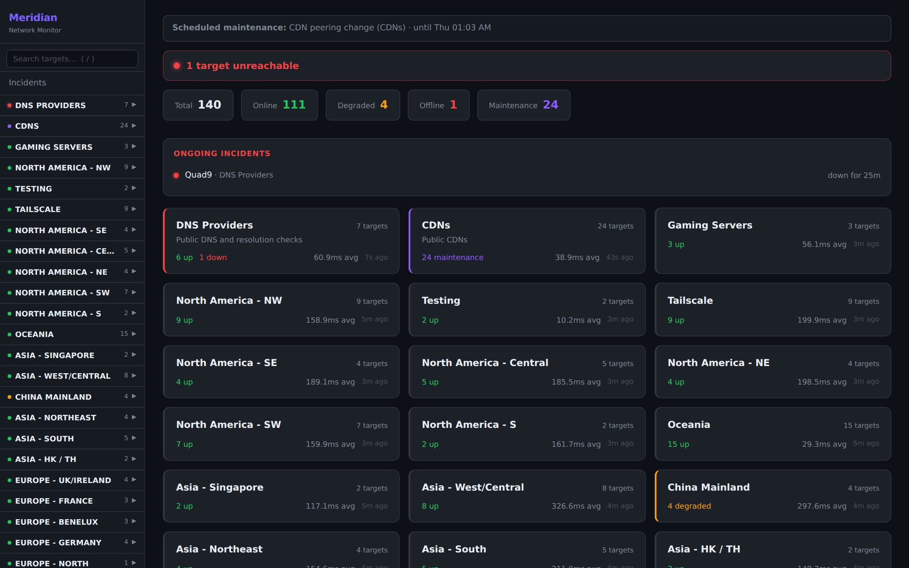
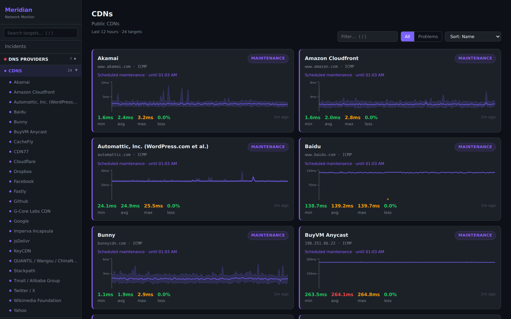
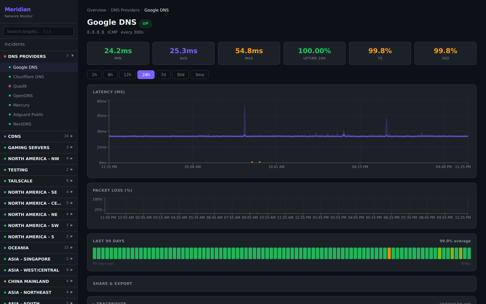
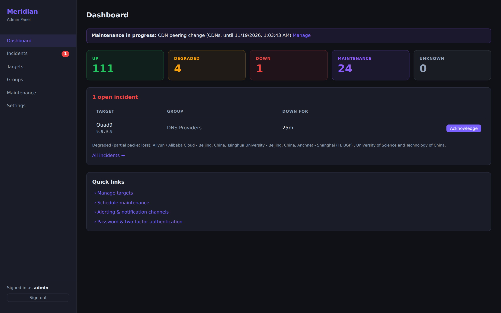
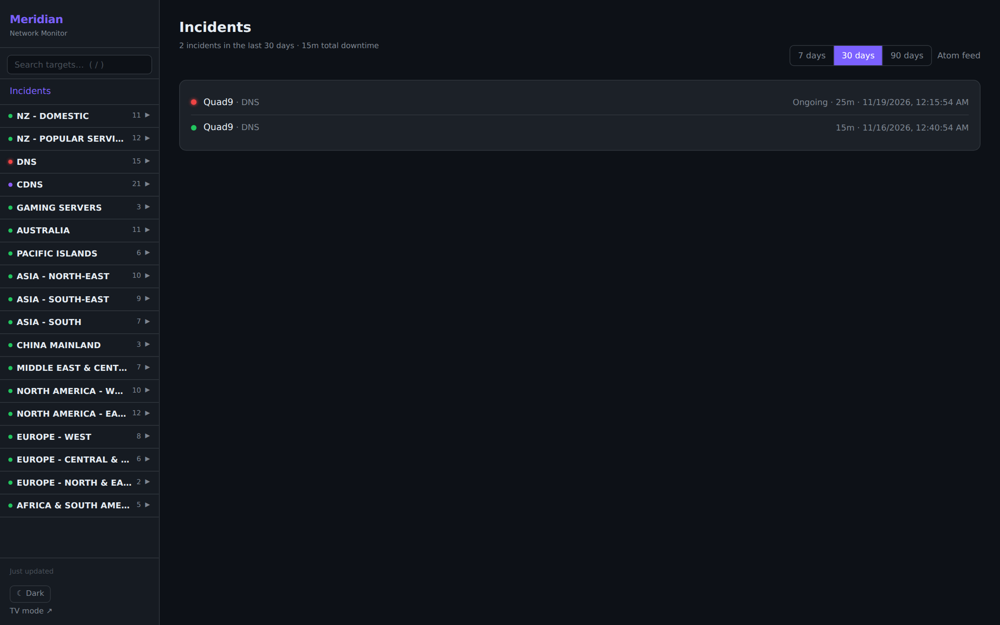
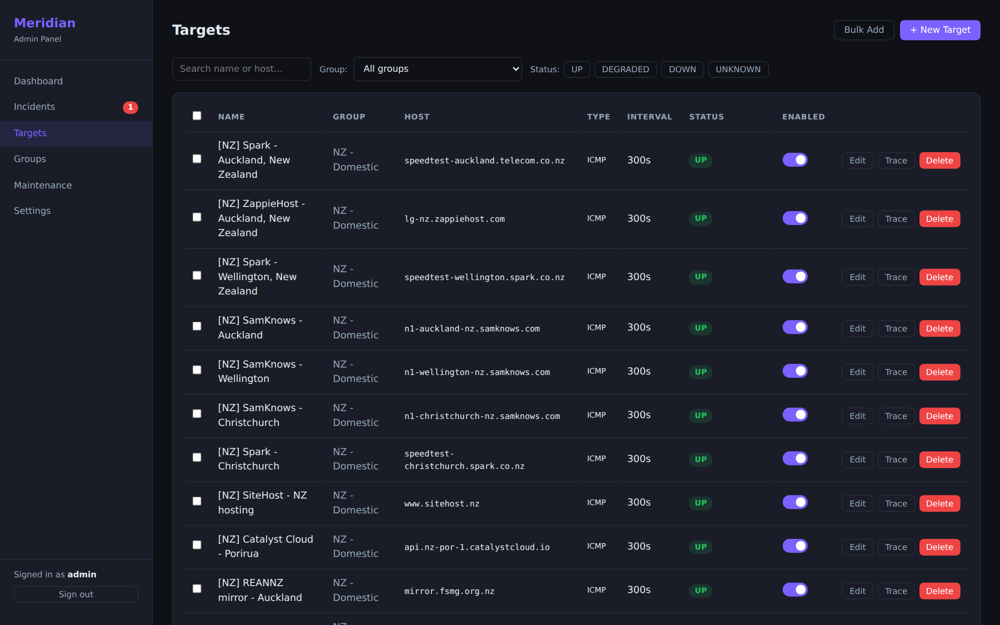
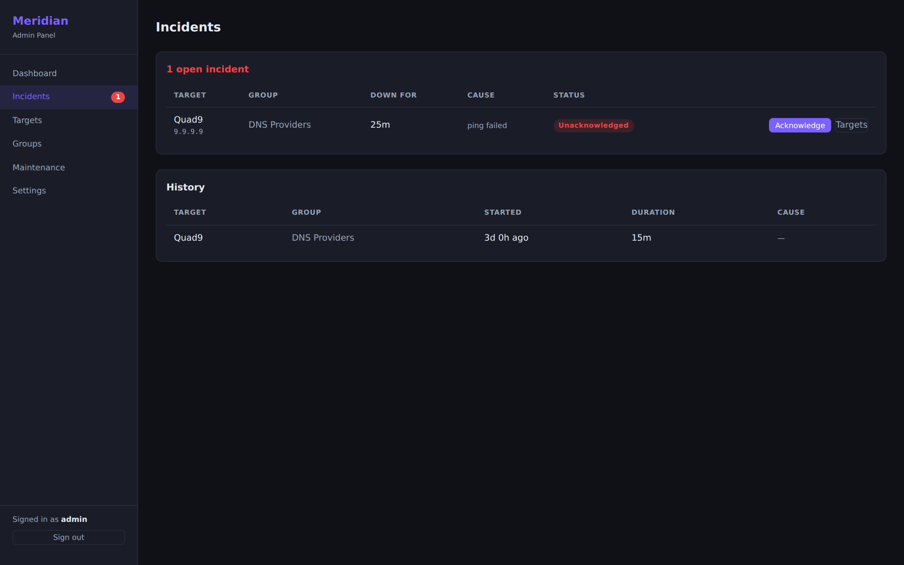
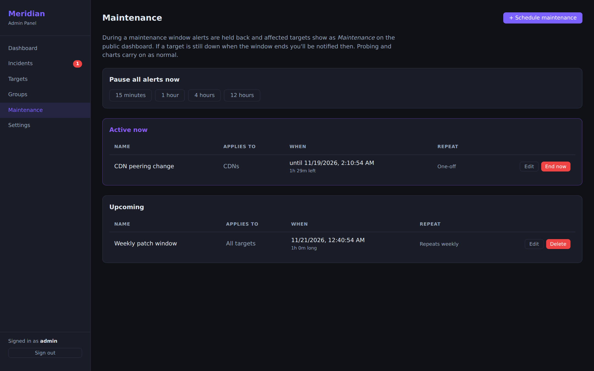

# Meridian

Modern network latency monitoring — a spiritual successor to SmokePing.

---

## Screenshots

**Public dashboard — overview**


**Public dashboard — group view**


**Public dashboard — target detail**


**Admin — dashboard**


**Public — incidents**


**Admin — targets**


**Admin — incidents (acknowledge)**


**Admin — maintenance windows**


---

## Architecture

```
                           ┌─────────────────────────────────────────────┐
                           │                  Linux VPS                   │
                           │                                              │
  Browser (public) ──────▶ │  Cloudflare Tunnel ──▶ meridian-api         │
                           │                         (127.0.0.1:3001)    │
                           │                              │               │
  Browser (admin)  ──────▶ │  LAN / Tailscale   ──▶ meridian-admin       │
  (LAN/Tailscale only)     │                         (ADMIN_HOST:3002)   │
                           │                              │               │
                           │                         meridian-probe       │
                           │                         (no HTTP port)       │
                           │                              │               │
                           │                         SQLite (WAL)         │
                           │                         data/meridian.db     │
                           └─────────────────────────────────────────────┘
```

## Port Map

| Port | Process | Bind | Exposure |
|---|---|---|---|
| 3001 | `meridian-api` | `127.0.0.1` | Cloudflare Tunnel only |
| 3002 | `meridian-admin` | `127.0.0.1` (set `ADMIN_HOST` for LAN/Tailscale) | Never public |
| — | `meridian-probe` | none | internal |

---

## Features

- **ICMP, ICMPv6, DNS, TCP-port and HTTP(S) probing** with configurable intervals and packet counts
- **Latency charts** — raw, 5-min rollup, and 1-hour rollup with selectable time ranges
- **Uptime tracking** — 24h / 7d / 30d per target
- **Traceroute** — automatic daily runs per target with reverse DNS, path-change history stored when routes shift significantly
- **Status history ribbon** — last 20 probe outcomes per target
- **Groups** — targets organised into groups, drag-and-drop reordering in admin
- **Public dashboard** — read-only view with live search, group cards, per-target detail pages
- **Admin panel** — full CRUD for groups and targets, bulk add/edit/enable/disable/delete, group-filtered and status-filtered views
- **Incidents** — an outage is confirmed by N consecutive failed probes (no more alerts for a single dropped ping), tracked with start/end/duration, and can be **acknowledged**
- **Maintenance windows** — one-off or repeating (daily/weekly) per target, group or everything; alerts are held, targets show as *Maintenance* publicly, and anything still down when the window ends alerts then
- **Notifications** — multi-channel alerts on DOWN, recovery and (optionally) reminders; Slack, Discord, ntfy, Telegram, and generic webhooks; alert floods are batched into a digest
- **Two-factor authentication** (TOTP) with recovery codes, self-service password change, and an admin **audit log**
- **Prometheus `/metrics`** endpoint, embeddable **status badges**, an **Atom feed** of incidents, and CSV export of any chart range
- **90-day availability bars**, light/dark theme, and a mobile-friendly public dashboard
- **Config import/export** — backup and restore all groups and targets as JSON (import merges by default and never deletes history unless you pick *Replace*)
- **Data retention** — configurable rolling windows for raw, 5-min, and 1-hour data
- **Banner system** — info/warning/maintenance banners on the public dashboard
- **Rate limiting and security headers** on both servers

---

## Setup

### Prerequisites

- Node.js ≥ 20
- npm
- `ping` binary available (standard on Linux)
- `traceroute` binary available (`apt install traceroute`)
- PM2: `npm install -g pm2`
- (Optional) `cloudflared` for public access

### Quick start

```bash
git clone <your-repo> meridian
cd meridian
bash scripts/setup.sh
```

The setup script will:
1. Check Node.js ≥ 20
2. Install npm dependencies
3. Run database migrations (idempotent)
4. Optionally seed example targets
5. Create the initial admin user
6. Build both Vite frontends

Then start all processes:

```bash
pm2 start ecosystem.config.js
pm2 save
pm2 startup   # follow the printed command to enable auto-start
```

---

## Cloudflare Tunnel (public UI)

```bash
# Install cloudflared
curl -L https://pkg.cloudflare.com/cloudflare-main.gpg | sudo apt-key add -
echo "deb https://pkg.cloudflare.com/cloudflared $(lsb_release -cs) main" | sudo tee /etc/apt/sources.list.d/cloudflared.list
sudo apt update && sudo apt install cloudflared

# Authenticate
cloudflared tunnel login

# Create tunnel
cloudflared tunnel create meridian

# Route your domain to the public API
cloudflared tunnel route dns meridian your-domain.example.com

# Start tunnel pointing at the public API
cloudflared tunnel run --url http://127.0.0.1:3001 meridian
```

The public server already binds to `127.0.0.1` only, so it is not reachable without the tunnel.

---

## Firewall Recommendations

```bash
# The public API is on 127.0.0.1 — no firewall rule needed, it is not reachable externally.

# Block admin port from public internet
sudo ufw deny 3002

# If using Tailscale, allow admin port from Tailscale subnet only
sudo ufw allow from 100.64.0.0/10 to any port 3002

sudo ufw enable
```

---

## First Login

Navigate to: `http://127.0.0.1:3002` (or `http://<tailscale-or-lan-ip>:3002` after setting `ADMIN_HOST` in `.env`)

Use the admin credentials you created during setup.

---

## Upgrade Steps

```bash
git pull
npm install
npm run migrate      # takes an automatic snapshot of the database first
npm run build
pm2 restart all
```

`npm run migrate` must run **before** the restart: the servers refuse to start against a database that hasn't been migrated and print the command to run. Migrations are versioned and idempotent, and each one that changes an existing database writes a `data/meridian.db.pre-migrate-…` snapshot first.

Run the test suite any time with `npm test`.

---

## Configuration

Copy `.env.example` to `.env` and edit before first run.

| Variable | Default | Description |
|---|---|---|
| `PUBLIC_PORT` | `3001` | Public API / SPA port |
| `ADMIN_PORT` | `3002` | Admin API / SPA port |
| `DATABASE_PATH` | `./data/meridian.db` | SQLite database path |
| `SESSION_SECRET` | — | **Must be changed** — random 32-byte string. Also encrypts 2FA secrets, so changing it later disables everyone's 2FA |
| `PUBLIC_HOST` | `127.0.0.1` | Interface the public API binds to |
| `ADMIN_HOST` | `127.0.0.1` | Interface the admin server binds to. Set `0.0.0.0` (or a LAN/Tailscale IP) to reach it over a trusted network |
| `TRUST_CF_HEADERS` | — | `true` when behind the Cloudflare Tunnel: trusts the loopback proxy for the real client IP (rate limits, audit log) |
| `TRUSTED_PROXIES` | — | Comma-separated proxy IPs to trust instead (e.g. `cloudflared` on another host) |
| `METRICS_TOKEN` | — | Enables `/metrics` on the admin port (16+ characters, otherwise ignored); scrape with `Authorization: Bearer <token>` |
| `PROBE_CONCURRENCY` | `15` | Maximum probes running at once |
| `RETENTION_RAW_DAYS` | `7` | Days to keep raw probe results |
| `RETENTION_5MIN_DAYS` | `30` | Days to keep 5-min aggregates |
| `RETENTION_1HOUR_DAYS` | `365` | Days to keep 1-hour aggregates |

---

## Probe Types

| Type | Mechanism | Metrics |
|---|---|---|
| ICMP | System `ping` binary | latency min/avg/max/mdev, packet loss, raw RTTs |
| ICMPv6 | `ping -6` | as ICMP, IPv6 only |
| DNS | Node `dns.resolve4()` | resolution time, success/fail, resolved IP |
| TCP | Connect attempts to `host:port` (IPv6: `[addr]:port`) | connect time as latency, refused/timeout as loss |
| HTTP(S) | One `GET` to a full URL; redirects not followed | time to response headers; 2xx/3xx = up, 4xx/5xx/timeout/TLS error = down |

---

## Traceroute

Traceroutes run automatically at startup and once daily per target (refresh window: 24 hours). A new history entry is stored whenever the path changes significantly (≥30% of hops differ from the previous run).

- Uses `traceroute -n` to avoid per-hop DNS delays during the trace
- Reverse DNS is resolved in parallel after the trace completes
- Up to 50 historical path snapshots are retained per target
- Private/RFC-1918 hops are hidden from the public view

---

## Incidents, alerts and acknowledgement

An **incident** opens when a target fails `N` probes in a row (Settings → Alerting, default 2) and closes when it recovers. This replaces alerting on a single bad probe. Alerts are sent when an incident opens and when it closes (with how long it lasted). Optionally, a reminder repeats every *M* minutes until someone clicks **Acknowledge** on the Incidents page; the acknowledgement is visible to other admins, silences reminders, and clears itself on recovery. Partial packet loss (*Degraded*) never alerts.

### Maintenance windows

**Maintenance** in the admin sidebar. A window covers everything, one group or one target, and can repeat daily or weekly. While one is active, alerts are held and the public dashboard shows the affected targets as *Maintenance* with an automatic banner. Probing and charts continue. If a target is *still down* when the window ends, the held alert is sent then; if it recovered during the window, nothing is sent. "Pause all alerts now" gives one-click 15 min – 12 h windows. Repeating windows use fixed UTC offsets, so they shift by an hour across DST changes.

### Notification channels

| Type | URL format |
|---|---|
| Slack | `https://hooks.slack.com/services/T.../B.../...` |
| Discord | `https://discord.com/api/webhooks/ID/TOKEN` |
| ntfy | `https://ntfy.sh/TOPICNAME` (or self-hosted) |
| Telegram | `tgram://BOTTOKEN/CHATID` |
| Generic webhook | Any `https://` or `http://` URL |

URLs pointing at link-local/cloud-metadata addresses (`169.254.x.x`) are refused. Set a **public base URL** in Settings → Alerting and every alert links to the target's page.

### Flood protection

If more than 5 alerts fire within 60 seconds (a mass outage or mass recovery) further ones are held for 5 minutes and then sent as **one digest message** listing what went down and what recovered, so nothing is silently dropped.

### Generic webhook payload

```json
{
  "event": "down",
  "incident_id": 42,
  "target": "Google DNS",
  "host": "8.8.8.8",
  "group": "DNS Resolvers",
  "status": "DOWN",
  "previous_status": "UP",
  "duration_seconds": 120,
  "cause": "ping failed",
  "message": "🔴 Google DNS is DOWN — 8.8.8.8 (DNS Resolvers)",
  "target_url": "https://status.example.com/target/5",
  "timestamp": "2026-06-19T10:00:00.000Z"
}
```

`event` is `down`, `recovered` or `reminder`. The original fields are unchanged; `event`, `incident_id`, `duration_seconds` and `cause` are new.

---

## Two-factor authentication

Settings → **My account**. Scan the QR code with any TOTP app (Google Authenticator, Authy, 1Password, Bitwarden…), confirm with a code, and save the ten one-time **recovery codes** shown. Sign-in then needs the password and a code. Codes can't be replayed within their 30-second window. Secrets are encrypted at rest with a key derived from `SESSION_SECRET`.

Lost your phone and recovery codes? Another admin can use Settings → Users → **Reset 2FA**. If you are the only admin, run in the project directory:

```bash
node -e "require('./server/db/db').getDb().prepare('UPDATE admin_users SET totp_enabled=0,totp_secret=NULL,recovery_codes=NULL WHERE username=?').run('YOUR_USERNAME')"
```

Changing your password, or turning 2FA on, signs out all your other sessions.

---

## Metrics, badges and feeds

- **Prometheus**: set `METRICS_TOKEN` in `.env`, restart `meridian-admin`, then scrape `http://<admin-host>:3002/metrics` with `Authorization: Bearer <token>`. Exposes `meridian_target_up`, `_latency_seconds`, `_jitter_seconds`, `_packet_loss_ratio`, `_uptime_ratio{window}`, `_last_probe_timestamp_seconds`, `_in_maintenance`, `_incident_open`, plus fleet totals and database size. Without a token the route does not exist.
- **Status badge**: `https://your-host/badge/<target-id>.svg` (add `?label=My%20Site`) — see *Share & export* on any target page for copy-paste Markdown/HTML.
- **Incident feed**: `https://your-host/feed.atom`.
- **Public API** (read-only, JSON): `/api/v1/summary`, `/groups`, `/incidents`, `/targets/:id`, `/targets/:id/results?range=`, `/targets/:id/availability?days=`.

---

## Security Notes

See also [SECURITY.md](SECURITY.md) for a deployment hardening checklist and how to report vulnerabilities.


- Sessions: 32-byte random token, stored as SHA-256 hash, httpOnly cookie, 24h sliding expiry
- CSRF: double-submit cookie (`X-CSRF-Token` header + `csrf_token` cookie)
- Passwords: bcrypt cost factor 12, minimum 10 characters; changing your own requires the current one
- Admin login: failed attempts are limited per IP (10) and per username (8) per 15 minutes; unknown users and wrong passwords are indistinguishable (including timing)
- Optional TOTP two-factor authentication with single-use recovery codes
- Every admin change is recorded in the audit log (never request bodies)
- Hosts are validated so they can never be parsed as command-line options by `ping`/`traceroute`
- All SQL uses parameterised statements
- Rate limiting on public API: 600 requests/minute per IP

---

## License

[MIT](LICENSE) — use it, fork it, make your own version.
